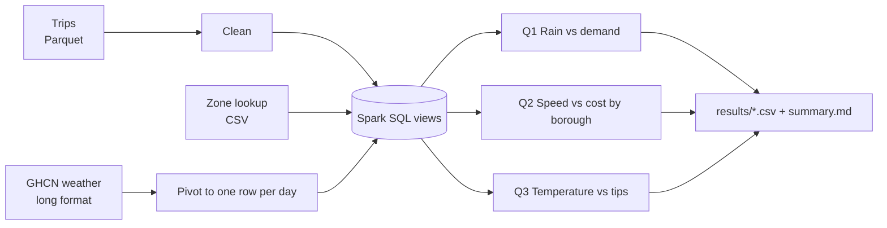
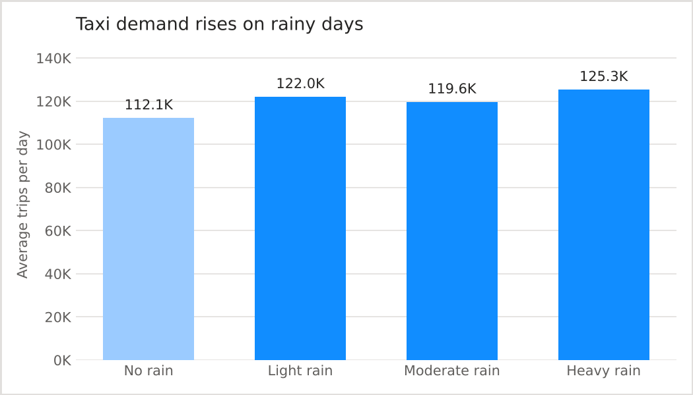
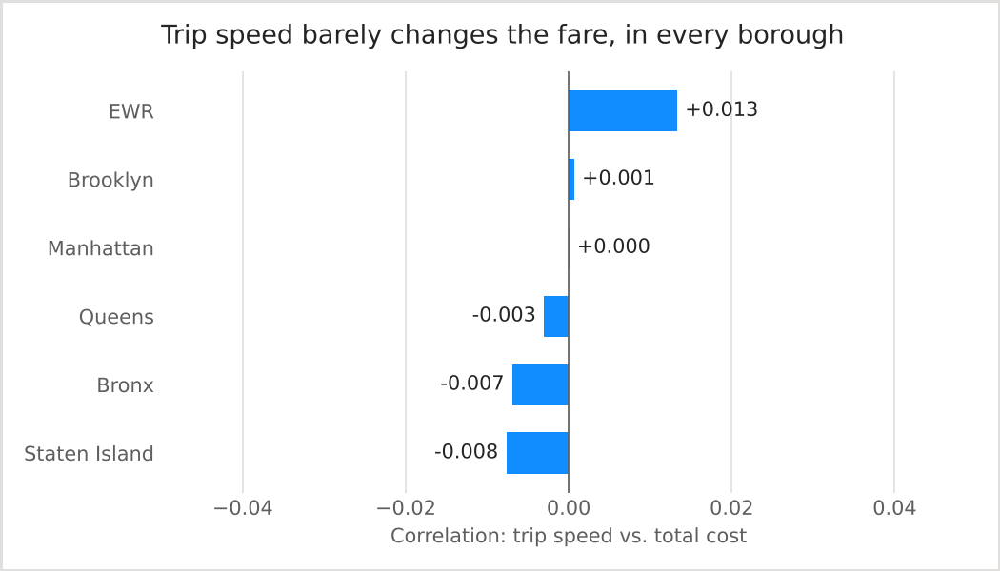

# NYC Taxi Demand & Pricing Analysis (PySpark)

[](https://github.com/achux11/nyc-taxi-spark-analysis/actions/workflows/ci.yml)
[](https://www.python.org/)
[](https://spark.apache.org/docs/3.5.3/api/python/)

**Does rain bring more taxi riders?** What drives taxi demand and fares in New York City? This project joins NYC taxi trip records with zone and weather data in **Apache Spark** and answers three business questions:

1. **Does rain change taxi demand?**
2. **Does trip speed change what a rider pays, borough by borough?**
3. **Does the day's temperature change how much riders tip?**

> **About this repo:** this analysis started as my Big Data course project at UT Dallas (Fall 2025), built with Hive and Spark. The original code was lost, so I rebuilt it from scratch in PySpark. It answers the same three questions on public data, and anyone can rerun it.

---

## Data

| Dataset | Source | What it adds |
|---|---|---|
| Yellow taxi trips | [NYC TLC Trip Record Data](https://www.nyc.gov/site/tlc/about/tlc-trip-record-data.page) (monthly Parquet) | Pickup/dropoff time, distance, location, fare, tip, total |
| Taxi zone lookup | TLC `taxi_zone_lookup.csv` | Maps each location ID to a zone and borough |
| Daily weather | [NOAA GHCN-Daily](https://www.ncei.noaa.gov/pub/data/ghcn/daily/), Central Park (USW00094728) | Daily high/low temperature, rainfall, snow, wind |

Trips are joined to zones on the pickup location ID, and to weather on the pickup date.

## Pipeline



**Cleaning rules** (`src/taxi_analysis/clean.py`). Raw TLC data has duplicates and impossible values, so each trip must pass all of these:

| Rule | Why |
|---|---|
| Drop exact duplicate rows | Same trip recorded twice |
| Drop rows missing time, distance, location or fare | Can't be analyzed |
| Pickup inside the chosen date range | Monthly files contain stray trips from other years |
| Distance between 0 and 100 miles | Zero or huge distances are recording errors |
| Duration between 1 and 180 minutes | Removes zero-length and stuck-meter trips |
| Fare and total above $0, tip not negative | Refunds and voids |
| Speed at most 80 mph | Impossible speeds mean a bad time or distance |

**Analysis** (`src/taxi_analysis/analysis.py`) is written in **Spark SQL** over temporary views:
- **Q1:** daily trip counts joined to daily rainfall, grouped into no / light (< 2.5 mm) / moderate (< 10 mm) / heavy rain, plus the correlation between trips and rainfall. Weekday averages are shown separately, because weekends change demand on their own.
- **Q2:** per pickup borough, the correlation of trip speed with total amount paid, compared with the correlation of distance with total amount paid.
- **Q3:** daily average tip % on **card trips only** (TLC data doesn't record cash tips), correlated with the daily high temperature.

## Run it

**Easiest:** open [`notebooks/run_in_colab.ipynb`](notebooks/run_in_colab.ipynb) in Google Colab and run all cells.

**Locally** (needs Java 8, 11 or 17):
```bash
pip install -r requirements.txt
python download_data.py --year 2023 --months 1-6      # about 300 MB
python run_analysis.py --start 2023-01-01 --end 2023-07-01
pytest -q                                              # tests use small hand-made data
```
Results are written to `results/`: one CSV and one chart per question, plus a `summary.md`.

## Findings from the original course project

From the Fall 2025 course version (Hive + Spark on the TLC trip data, zone lookup and NOAA weather):



**Rain vs. demand:** demand rose with rainfall, from about **112K** trips on an average dry day to **125K** on heavy-rain days, about **12% more**. Correlation between daily trips and rainfall: 0.16.



**Speed vs. cost:** the correlation is close to zero in every borough. Fares follow distance and the fare rules, not traffic speed.

**Temperature vs. tips:** correlation of 0.005. Tipping stays the same whatever the weather.

**Recommendations:** use rain forecasts to send more taxis to busy zones before storms, and consider rain-based dynamic pricing. Don't forecast tips from temperature; trip and zone patterns matter far more.

*A run of this rebuilt version saves the same charts to `results/`. Its numbers can differ slightly from the course version, since the months and cleaning rules may not match exactly.*

## Project structure

```
download_data.py            # get trips, zones and weather
run_analysis.py             # clean, answer Q1-Q3, write results/
src/taxi_analysis/
    load.py                 # read Parquet/CSV, pivot GHCN weather
    clean.py                # cleaning rules
    analysis.py             # Spark SQL for the three questions
    charts.py               # PNG charts for each question
tests/test_pipeline.py      # cleaning and analysis tests on small data
notebooks/run_in_colab.ipynb
```

## Limitations

- Correlation is not cause. Rainy days also differ in season and day of week.
- Weather comes from one station (Central Park) for the whole city.
- Tip analysis covers card trips only.
